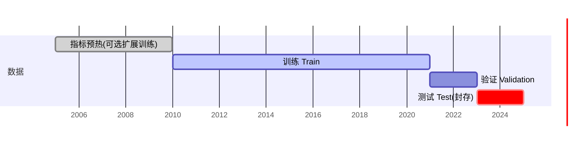
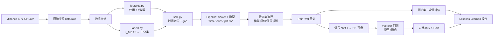
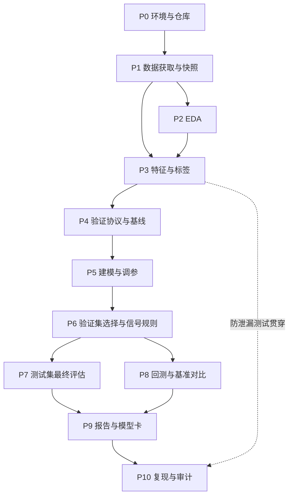

# S&P 500（SPY）交易信号模型 — 需求分析与开发计划

> 版本：1.0｜日期：2026-10-10｜Module 3 Group 7
> 依据：《Machine Learning Project: S&P 500 Trading Model》（下称“项目书”）与《Module3_知识总汇与项目实践规范》（下称“知识文档”）。
> 英文版：[SPY_Trading_Model_Requirements_and_Plan_EN.md](SPY_Trading_Model_Requirements_and_Plan_EN.md)
>
> **说明：**本文是开工前的需求分析与计划。文中所有参数（日期、阈值、窗口、费用）都是**默认设计决策**，尚未运行任何实验；凡标注“验证集确认”的项目，必须在合法验证流程中确定，不能以测试集结果回填。

---

## 1. 项目概述

### 1.1 一句话问题定义

> 在**每个交易日 t 收盘后**，仅使用**截至 t 日收盘已公开的 SPY 日线 OHLCV 数据**，对 **SPY** 判断**未来 5 个交易日收益所属区间（Buy / Hold / Sell）**，供**模拟交易策略**在 **t+1 日开盘**执行建仓/平仓，受**交易费 0.1%/每侧及滑点**约束，以**验证集 macro-F1** 作为模型选择依据，以**扣费后回测表现与 Buy & Hold 对比**作为实践评价。

### 1.2 项目性质

| 项目 | 内容 |
|---|---|
| 任务类型 | 时间序列多分类（Buy=1 / Hold=0 / Sell=−1） |
| 难度 | 高级（概念难点在验证协议与防泄漏，而非算法复杂度） |
| 主要教学目标 | ① 稳健的时间序列验证；② 防止数据泄漏 / look-ahead bias；③ 区分“分类成绩”与“扣费后可执行收益” |
| 评分重点 | 方法论、代码质量、对结果的解释，**不是赚了多少钱** |
| 预期结果 | 三类平衡情形下 ~35–40% 准确率属正常；扣费后大概率跑输 Buy & Hold，这是可接受的结论 |

### 1.3 资料优先级

1. 项目书的明确要求（必须满足）；
2. 本组在本文中作出的设计决策（可在验证流程中修改，修改须记录）；
3. 知识文档的通用原则与严谨性修正（默认遵循）。

---

## 2. 需求分析

### 2.1 功能需求追踪表

| 编号 | 项目书要求 | 课程依据 | 实施决策 | 验收标准 |
|---|---|---|---|---|
| R-01 | 获取 SPY 历史日线 OHLCV | 3.6 / 阶段 2 | `yfinance` 下载 SPY 2005-01-01 至 2024-12-31，保存原始快照 CSV 与抓取日期 | `data/raw/spy_YYYYMMDD.csv` 存在；README 记录来源、时间、复权方式 |
| R-02 | 价格转换为收益（非平稳） | 3.6 平稳性 | 使用 1/5/10/20 日收益（`pct_change`），不直接把价格作为特征 | 特征矩阵中不含原始价格列 |
| R-03 | 至少 3 种技术指标 | 特征工程 | SMA 比值、RSI(14)、MACD(12,26,9)、Bollinger Bands(20,2) 共 4 种 | `features.py` 中每个指标有公式注释与窗口参数 |
| R-04 | 历史波动率度量 | 3.6 | 20 日收益滚动标准差；ATR(14)/Close 作为补充 | 特征列存在且 EDA 中展示分布 |
| R-05 | 特征严格滞后 | 3.6 lag / shift | 所有特征只用 ≤ t 日收盘数据；信号在 t+1 开盘执行 | 截断测试通过（见 3.9） |
| R-06 | 连续未来收益 → 三分类 | 3.3 + 3.6 | `r_fwd(t,5)=Close(t+5)/Close(t)−1`，±1% 阈值 | `labels.py` 单元测试；EDA 展示类别分布 |
| R-07 | 严格按时间切分，禁止随机切分 | 3.6 / 阶段 3 | Train 2010–2020 / Val 2021–2022 / Test 2023–2024，边界 5 日 gap；训练内 `TimeSeriesSplit` | 代码中无 `train_test_split`、无 `shuffle=True`；切分日期断言 |
| R-08 | 处理类别不平衡 | 3.3 / 3.4 | 主方案 `class_weight="balanced"`；对照阈值调整；SMOTE 仅可选且只在训练折内 | 实验记录中有“有/无平衡策略”对比 |
| R-09 | 从可解释表格模型开始，不用深度学习 | 3.3 / 3.4 | 基线 → 逻辑回归 → 随机森林 → HistGradientBoosting（LightGBM/XGBoost 可选） | 建模 notebook 按此顺序；无神经网络 |
| R-10 | 无 look-ahead bias（会被审计） | 全课程原则 5 | 预处理全部置于 Pipeline；防泄漏自动化测试；测试集只访问一次 | `tests/` 全部通过；审计清单逐项勾选 |
| R-11 | EDA Notebook | 阶段 2 | 特征分布、指标相关性、目标类别分布（含按年份变化） | `01_eda.ipynb` 可从头运行 |
| R-12 | 建模 Notebook（核心） | 阶段 4–7 | 数据管线、特征、训练、超参调优、验证选择、最终测试 | `02_modeling.ipynb` 可从头运行，有 Markdown 解释 |
| R-13 | 专用回测库 | 项目书 | `vectorbt`（备选 `backtrader`） | `03_backtest.ipynb` 使用 vectorbt Portfolio |
| R-14 | 回测含交易费 / 滑点 | 项目书 | 费用 0.1% 每侧 + 滑点 0.05%；费用敏感性 0 / 0.05% / 0.1% / 0.2% | 回测参数显式写出；敏感性表 |
| R-15 | 与 Buy & Hold 对比并作图 | 3.1 基线 | 同期、同初始资金、同费用假设的 Buy & Hold；净值曲线叠加图 | `outputs/figures/equity_vs_bh.png` |
| R-16 | Lessons Learned 报告 | 阶段 7 | 失败点、跑输/跑赢原因、金融预测难点 | `outputs/report.md` 含四问失败分析 |

### 2.2 非功能需求

| 编号 | 需求 | 实施方式 |
|---|---|---|
| N-01 | 可复现 | 固定随机种子；`requirements.txt` 锁定版本；保留原始数据快照；一键运行顺序写入 README |
| N-02 | 代码质量 | 可复用逻辑放在 `src/`，notebook 只做调用与展示；函数有 docstring；`ruff` 格式检查 |
| N-03 | 可审计 | 防泄漏单元测试；实验记录表；测试集结果单独成节 |
| N-04 | 诚实报告 | 区分实际运行结果、教学示例与未验证推断；保留失败实验 |
| N-05 | 训练/使用一致 | 同一 `features.py` 用于训练与回测信号生成；保存完整 Pipeline（`joblib`） |

### 2.3 需求歧义点与本组决定

知识文档第五部分指出项目书有若干未定义之处，必须在开工前明确：

| 歧义点 | 本组决定 | 理由 / 后续处理 |
|---|---|---|
| 标签收益口径与实际成交价不一致 | 主标签按项目书：收盘到收盘 `Close(t+5)/Close(t)−1`；执行价为 t+1 开盘 | 保持与项目书一致；在报告中讨论口径差异，并做一次“开盘到开盘标签” `Open(t+6)/Open(t+1)−1` 的敏感性实验 |
| 信号能否在 t 日收盘成交 | **不能**。t 日收盘后才有完整数据，最早在 t+1 开盘成交 | 避免隐性 look-ahead |
| 费用 0.1% 是每侧还是往返 | **每侧**（每次买入或卖出各收 0.1%），另加 0.05% 滑点 | 偏保守；敏感性分析覆盖其他口径 |
| Sell 的含义 | 主策略 **long-only**：Sell = 平仓转现金；long/short（Sell=做空）作为可选变体 | 与 Buy & Hold 可比性更好，避免做空成本假设 |
| Hold 的含义 | **维持当前仓位**，不产生交易 | 减少不必要换手 |
| 每日信号与 5 日持有期如何结合 | 每日重新评估信号（状态机：Buy→持有多头，Sell→空仓，Hold→不变）；“最短持有期”作为可选规则，在验证集确认 | 标签 horizon 是 5 日，但交易决策逐日更新，报告中说明 |
| 重叠标签窗口 | 相邻样本的 5 日标签窗口重叠；切分边界设 5 个交易日 gap，训练集末尾标签必须在下一段开始前已知 | 防止跨边界泄漏；也提醒 CV 分数的样本并不独立 |
| 尾部无标签行 | 数据最后 5 个交易日无法计算标签，删除 | 不填充、不外推 |
| 指标预热期 | SMA200 需 200 日数据；2005–2009 数据只用于预热（及可选的扩展训练实验） | 避免 NaN 被填补成虚假值 |

---

## 3. 关键技术方案

### 3.1 数据

- 来源：`yfinance.download("SPY", start="2005-01-01", end="2025-01-01", auto_adjust=True)`。
- 复权：使用复权价（包含分红与拆分调整），收益计算口径一致；在 README 中说明 `auto_adjust` 设置，因为未复权价会把除息日误判为下跌。
- 快照：首次下载后保存 `data/raw/spy_<抓取日期>.csv`，后续所有 notebook 读快照，不重复联网下载（yfinance 历史数据可能被修订）。
- 数据审计：交易日连续性、缺失、重复日期、`High ≥ max(Open, Close)`、`Low ≤ min(Open, Close)`、Volume>0、极端收益（如 2020-03）核对。

### 3.2 目标标签

$$r_{fwd}(t,5)=\frac{Close_{t+5}}{Close_t}-1$$

| 类别 | 编码 | 默认条件 |
|---|---|---|
| Buy | 1 | `r_fwd > +1.0%` |
| Hold | 0 | `−1.0% ≤ r_fwd ≤ +1.0%` |
| Sell | −1 | `r_fwd < −1.0%` |

阈值备选方案（只能用训练集统计决定，并在验证集比较）：
- **分位数阈值**：取训练集 `r_fwd` 的 33%/67% 分位数，使三类近似平衡；
- **波动率缩放阈值**：`±k × σ_20(t) × √5`，让阈值随市场波动变化（σ 只用 ≤ t 数据）。

模型输入使用 sklearn 标签编码时，内部可映射为 {0,1,2}，输出时还原为 {−1,0,1}。

### 3.3 特征工程（全部仅用 ≤ t 日收盘数据）

| 组别 | 特征 | 公式 / 窗口 |
|---|---|---|
| 收益 | `ret_1, ret_5, ret_10, ret_20` | `Close_t / Close_{t−k} − 1` |
| 趋势（MA） | `close_sma20, close_sma50, close_sma200` | `Close_t / SMA_k(t) − 1` |
| 趋势（MA） | `sma20_sma50` | `SMA20 / SMA50 − 1` |
| 动量 | `rsi_14` | Wilder 平滑：`RSI = 100 − 100/(1+RS)`，RS=平均涨幅/平均跌幅（14 日） |
| 动量 | `macd_hist`（归一化） | `MACD = EMA12 − EMA26`；`Signal = EMA9(MACD)`；`hist = (MACD − Signal)/Close` |
| 均值回归 | `bb_pctb, bb_width` | 中轨 SMA20，上下轨 ±2σ₂₀；`%B=(C−Lower)/(Upper−Lower)`；`width=(Upper−Lower)/SMA20` |
| 波动率 | `vol_20` | `ret_1` 的 20 日滚动标准差 |
| 波动率 | `atr_14_norm` | ATR(14) / Close |
| 成交量 | `vol_z20` | `(log V_t − mean₂₀(log V)) / std₂₀(log V)` |
| 日历（可选） | `dow, month` | 星期、月份（事先已知） |

要点：
- 不使用 `center=True` 的滚动；不使用任何 `shift(-k)`（负向位移只允许出现在 `labels.py`）。
- 所有滚动统计在 t 日包含 t 日收盘，这是合法的，因为执行在 t+1 开盘。
- 标准化等**学习型**预处理放进 sklearn Pipeline，只在训练折内 `fit`。
- 指标之间高度相关（如 ret_5 与 RSI），在 EDA 中展示相关矩阵，并可做“去冗余特征子集”对照实验。

### 3.4 数据切分与验证协议



- **边界 gap**：每段训练数据丢弃最后 5 个交易日的样本，确保其标签窗口不进入下一段。
- **训练内 CV**：`TimeSeriesSplit(n_splits=5, gap=5)`（扩张窗口）用于超参搜索，评分 `f1_macro`。
- **验证集**：用于在候选模型之间选择、选择阈值方案与信号规则（概率边际、最短持有期）。
- **最终模型**：锁定配置后用 Train+Val（2010–2022）重训。
- **测试集**：2023–2024 只在 `02_modeling.ipynb` 最后一节与 `03_backtest.ipynb` 中**访问一次**；之后不再修改任何设计。若违反，须在报告中明确说明测试集角色已改变。
- **稳健性（可选）**：walk-forward 滚动评估（每年重训一次），展示不同市场阶段（2020 疫情、2022 加息）的表现差异。

### 3.5 类别不平衡

1. EDA 中报告整体与按年份的类别比例（预期 Buy 多于 Sell）。
2. **主方案**：`class_weight="balanced"`（LR / RF / HGB 均支持）。
3. **对照**：调整标签阈值（分位数阈值）或调整决策规则（如 `P(Buy) − P(Sell) > m`）。
4. **SMOTE（可选）**：仅通过 `imblearn.pipeline.Pipeline` 在训练折内过采样；需在报告中说明它在时间序列上的局限（合成样本跨时间插值，可能扭曲时序结构）。
5. 调整权重后，概率与阈值关系会改变，阈值必须重新在验证集上选择。

### 3.6 基线与候选模型

| 序号 | 模型 | 目的 | 关键超参（CV 搜索） |
|---|---|---|---|
| B0 | DummyClassifier(most_frequent) | 多数类基线 | — |
| B1 | DummyClassifier(stratified) | 随机猜测基线 | — |
| B2 | 恒定 Buy（= 始终持有） | 与 Buy & Hold 对应的交易基线 | — |
| B3 | 动量规则：`ret_20>0 且 Close>SMA200 → Buy`，`ret_20<0 且 Close<SMA200 → Sell` | 简单可解释规则基线 | — |
| M1 | LogisticRegression（multinomial，StandardScaler） | 可解释线性模型 | `C`、`class_weight` |
| M2 | RandomForestClassifier | 非线性、稳健 | `n_estimators, max_depth, min_samples_leaf, max_features` |
| M3 | HistGradientBoostingClassifier | 提升树 | `learning_rate, max_iter, max_depth, min_samples_leaf, l2_regularization` |
| M4（可选） | LightGBM / XGBoost | 与 M3 对照 | 同类参数 |

- 搜索方式：`RandomizedSearchCV`（或 `GridSearchCV`）+ 整个 Pipeline + `TimeSeriesSplit`，记录候选数量与搜索范围。
- 树模型偏向记忆噪声：优先较浅树、较大叶子、较小学习率+早停（早停的验证切片必须在训练数据内部按时间划分）。
- 解释：LR 系数（注意标准化与相关特征）、在**验证集**上的置换重要性；只描述模型关联，不作因果结论。

### 3.7 评价指标

| 层面 | 指标 | 用途 |
|---|---|---|
| 分类（主） | **macro-F1** | 模型与超参选择（每类同等权重，避免多数类掩盖） |
| 分类（辅） | balanced accuracy、accuracy、各类 precision/recall、混淆矩阵、log loss | 全面诊断；accuracy 必须与多数类基线并列报告 |
| 分类（按时期） | 按年份 macro-F1 | 检查市场阶段稳定性 |
| 回测 | 总收益、CAGR、年化波动、Sharpe（rf=0 假设需注明）、最大回撤、Calmar | 风险调整后收益 |
| 回测（交易） | 交易次数、换手率、持仓暴露时间、胜率、费用总额 | 解释费用影响 |

> 参照：三类平衡时 35–40% 准确率属正常；若出现 ~80% 准确率，首先排查泄漏。但这只是提醒，最终应与多数类及规则基线比较。

### 3.8 回测设计

- **库**：`vectorbt`（`Portfolio.from_signals`）。
- **信号到交易**：t 日收盘产生预测 → 信号整体 `shift(1)` → 以 t+1 日 **Open** 作为成交价。
- **主策略（long-only 状态机）**：Buy → 若空仓则买入；Sell → 若持仓则卖出转现金；Hold → 维持。
- **可选变体**：long/short（Sell=做空）；概率边际过滤（仅当 `max P` 超过阈值才交易）；最短持有期 5 日。变体参数只在验证期回测中选择。
- **成本**：`fees=0.001`（每侧）、`slippage=0.0005`；敏感性：fees ∈ {0, 0.0005, 0.001, 0.002}。
- **初始资金**：100,000 美元，全仓（size=100% 现金）。
- **基准**：同一时间段、同一初始资金、同一费用的 Buy & Hold（首日开盘买入、期末持有）。
- **输出**：净值曲线对比图（模型 vs Buy & Hold，标注买卖点）、回撤曲线、指标表、费用敏感性表。
- **期间**：验证期（2021–2022）用于选择信号规则；测试期（2023–2024）为最终报告。

### 3.9 防泄漏审计（Look-ahead Audit）

| 检查 | 方法 |
|---|---|
| 特征截断一致性 | 对任意日期 t，用截止到 t 的数据重新计算特征，结果必须与全量计算的 t 行完全相同（`tests/test_no_lookahead.py`） |
| 负向位移只在标签中 | 静态检查：`shift(-` 只出现在 `labels.py` |
| 标签正确性 | 人工构造价格序列，断言标签值 |
| 切分边界 | 断言 `train.index.max() + gap < val.index.min()`，测试集同理 |
| 预处理位置 | 所有 Scaler / 重采样在 Pipeline 内；无对全量数据的 `fit` |
| 执行时点 | 回测信号必须 `shift(1)`；断言首个交易日晚于首个信号日 |
| 测试集访问 | 全项目仅一处读取测试集分段；代码审查确认 |
| 异常好成绩 | 若验证 accuracy 远超 ~45% 或回测 Sharpe 异常高，暂停并排查 |

---

## 4. 系统设计

### 4.1 目录结构

```text
Module3 Group7 project/
  README.md                 # 问题、数据、环境、运行顺序、结论摘要
  requirements.txt          # 锁定版本
  knowledge&docs/           # 课程资料（只读）
  docs/                     # 本计划文档（中/英）
  data/
    raw/                    # yfinance 原始快照
    processed/              # 特征+标签表（parquet/csv）
  notebooks/
    01_eda.ipynb
    02_modeling.ipynb
    03_backtest.ipynb
  src/
    config.py               # 日期、阈值、窗口、费用、种子等常量
    data.py                 # 下载与加载快照、数据审计
    features.py             # 技术指标与特征（训练与回测共用）
    labels.py               # 未来收益与三分类标签
    split.py                # 时间切分、gap、CV 拆分器
    models.py               # Pipeline 与搜索空间
    evaluate.py             # 分类指标、混淆矩阵、按年评估
    backtest.py             # vectorbt 回测与基准
  tests/
    test_no_lookahead.py
    test_labels.py
    test_split.py
  outputs/
    figures/
    metrics.json
    experiment_log.csv
    model_card.md
    report.md               # Lessons Learned
  models/
    final_pipeline.joblib
```

### 4.2 数据流



---

## 5. 开发计划（阶段与依赖）

### 5.1 阶段依赖图



### 5.2 各阶段明细

| 阶段 | 输入 | 主要任务 | 产出 | 验收标准 |
|---|---|---|---|---|
| **P0 环境与仓库** | 无 | 创建 conda 环境（建议 Python 3.11，以兼容 vectorbt/numba）；`git init` 与 `.gitignore`（忽略大数据与模型文件）；建立目录结构；`config.py` 写入常量 | 环境、仓库骨架、`requirements.txt` | `import vectorbt, sklearn, yfinance` 成功；目录结构与 4.1 一致 |
| **P1 数据获取与快照** | 环境 | `data.py` 下载 SPY 2005–2024；保存快照；数据审计（缺失、重复、OHLC 一致性、极端值） | `data/raw/*.csv`、审计记录 | 快照可离线加载；审计问题有处理说明 |
| **P2 EDA** | 快照 | 价格与收益走势、收益分布（厚尾）、波动聚集、指标分布、指标相关矩阵、目标类别分布（整体/按年/按切分段）、阈值敏感性（不同阈值下类别比例） | `01_eda.ipynb`、`outputs/figures/eda_*` | 覆盖项目书三项必选 EDA 内容；结论写成 Markdown |
| **P3 特征与标签** | 快照、EDA 结论 | 实现 `features.py`、`labels.py`；预热期处理；编写防泄漏测试与标签测试 | `data/processed/`、`tests/` | `pytest` 全部通过；特征表无未来信息、无 NaN（预热期已剔除） |
| **P4 验证协议与基线** | 特征表 | 实现 `split.py`（三段切分 + gap + CV 拆分器）；运行基线 B0–B3 的 CV 与验证集成绩；建立实验记录表 | `experiment_log.csv` 中的 E00–E03 | 切分断言通过；基线成绩已记录，作为后续比较参照 |
| **P5 建模与调参** | P4 协议 | M1→M2→M3（→M4）依次实现 Pipeline；`RandomizedSearchCV` + `TimeSeriesSplit` 调参；对比有/无类别权重、不同阈值方案、去冗余特征子集 | 各候选的 CV macro-F1、最佳参数 | 每次实验只改一个主要因素并记录；无测试集访问 |
| **P6 验证集选择与信号规则** | P5 候选 | 在验证集比较候选（macro-F1、混淆矩阵、按年表现）；在验证期回测上选择信号规则（概率边际、最短持有期）；选定最终配置并冻结 | 冻结的配置（写入 `config.py`）与选择理由 | 选择规则事先写明；最终配置有可追溯的实验编号 |
| **P7 测试集最终评估** | 冻结配置 | Train+Val 重训，保存 `final_pipeline.joblib`；测试集一次性评估所有分类指标；与基线对比 | `metrics.json`、测试集混淆矩阵 | 测试只运行一次；结果与基线并列 |
| **P8 回测与基准对比** | 最终模型信号 | vectorbt 回测（测试期为主，验证期为辅）；Buy & Hold 基准；费用/滑点敏感性；long-only 与可选 long/short 对比 | `03_backtest.ipynb`、净值对比图、指标表 | 含费用；有 Buy & Hold 曲线叠加图；敏感性表完整 |
| **P9 报告与模型卡** | P7、P8 结果 | 撰写 Lessons Learned（见第 9 节）；模型卡（数据范围、目标、特征、切分、指标、限制、使用范围）；README 结论摘要 | `report.md`、`model_card.md`、README | 回答失败分析四问；实际结果与推断分开标注 |
| **P10 复现与审计** | 全部产出 | 新环境从头运行全部 notebook；按第 8 节清单逐项审计；代码格式检查 | 审计记录、最终提交 | 从快照重跑结果一致（允许库版本导致的微小差异并说明） |

### 5.3 关键里程碑（Gate）

| Gate | 时点 | 通过条件 |
|---|---|---|
| G1 数据就绪 | P1 结束 | 快照与审计完成 |
| G2 无泄漏特征 | P3 结束 | 防泄漏测试全部通过 |
| G3 配置冻结 | P6 结束 | 最终模型、阈值、信号规则全部确定并记录 |
| G4 测试解封 | P7 开始 | 只有通过 G3 后才允许读取测试集 |
| G5 交付 | P10 结束 | 核对清单全部勾选 |

---

## 6. 实验记录模板

| 实验 ID | 数据/切分版本 | 标签方案 | 特征集 | 不平衡处理 | 模型/参数 | CV macro-F1（均值±折间标准差） | 验证 macro-F1 | 验证期回测（扣费） | 结论 |
|---|---|---|---|---|---|---|---|---|---|
| E00 | v1 / 2010–20·21–22 | ±1%, 5d | — | — | Dummy most_frequent | 待运行 | 待运行 | — | 参照 |
| E01 | 同上 | 同上 | 全部 | balanced | LR C=? | 待运行 | 待运行 | 待运行 | 待填 |
| … | | | | | | | | | |

规则：
- 未运行的单元格写“待运行”，不得用课程示例数字填写；
- 折间标准差不是置信区间，也不是显著性检验；
- 测试集成绩只在冻结后另表报告。

---

## 7. 风险与应对

| 风险 | 表现 | 应对 |
|---|---|---|
| 数据泄漏 / look-ahead | 准确率或 Sharpe 异常高 | 第 3.9 节审计；先怀疑泄漏再相信结果 |
| 阈值/规则在验证集过拟合 | 验证好、测试差 | 限制候选数量；规则尽量简单；报告验证与测试的差距 |
| 市场制度变化（2020 疫情、2022 加息、2023–24 强势上涨） | 不同年份表现差异大 | 按年评估；可选 walk-forward；在报告中讨论 |
| 交易费吞噬收益 | 高换手策略扣费后亏损 | 换手统计；概率边际与最短持有期；费用敏感性 |
| 类别分布漂移 | 训练期与测试期 Buy/Sell 比例不同 | 分段报告类别比例；对比固定阈值与波动率缩放阈值 |
| 标签口径与执行价不一致 | 分类好但回测差 | 敏感性实验（开盘到开盘标签）；报告中解释 |
| 重叠标签导致 CV 乐观 | CV 分数偏高 | gap 设置；不把折间波动当作置信区间 |
| 库版本兼容 | vectorbt/numba 在当前 Python 3.14 环境可能无法安装 | 独立 conda 环境（Python 3.11）；备选 backtrader |
| yfinance 数据变动/接口失效 | 重跑结果不同 | 本地快照；记录抓取日期 |
| 多重比较 | 尝试过多组合后“碰巧”找到好结果 | 实验全部记录，包括失败实验；报告尝试数量 |

---

## 8. 交付物与完成核对清单

### 8.1 交付物（项目书要求）

- [ ] EDA Notebook（特征分布、指标相关性、目标类别分布）
- [ ] 建模 Notebook（数据管线、特征、训练、超参调优）
- [ ] 使用专用回测库的回测（含交易费/滑点）
- [ ] 模型净值 vs Buy & Hold 对比图
- [ ] Lessons Learned 报告

### 8.2 方法审计清单（知识文档第五部分）

- [ ] 问题、样本单位（交易日）、预测起点（t 收盘）、标签与窗口（5 日）已明确
- [ ] 数据来源、版本、复权方式、覆盖范围与清理记录可追溯
- [ ] 有公平的简单基线（多数类、随机、恒定 Buy、动量规则、Buy & Hold）
- [ ] 切分严格按时间，边界有 gap
- [ ] 所有训练统计、重采样、特征选择只在训练范围内拟合
- [ ] 超参、阈值、信号规则、早停均来自训练内 CV 或验证集
- [ ] 测试集没有用于修改方案
- [ ] 指标与行动一致，未以 accuracy 或漂亮曲线代替证据
- [ ] 回测模拟真实执行时点（t+1 开盘）并计入成本
- [ ] 特征重要性未被解释为因果
- [ ] 实际结果、示例与未验证推断分开标注；包含失败与按时期分析
- [ ] 代码、数据快照、环境可按 README 复现
- [ ] 模型卡说明使用范围与限制

---

## 9. Lessons Learned 报告骨架

```markdown
# Lessons Learned
## 1. 结果摘要
- 测试集分类指标 vs 基线；扣费回测 vs Buy & Hold（同期、同资金、同费用）
## 2. 模型在哪里失败
- 混淆矩阵：哪些类别最常被混淆（预期 Hold 与相邻类别混淆最多）
- 按年份/市场阶段的表现
## 3. 为什么跑输（或跑赢）基准
- 费用与换手；错过的大涨日；标签口径与执行价差异；类别漂移
## 4. 模型学到的是稳健信号还是偶然模式？
- 验证与测试差距；特征重要性稳定性；泄漏排查结果
## 5. 金融市场预测为何困难
- 低信噪比、近似有效市场、非平稳与制度变化、厚尾、重叠标签导致有效样本少
## 6. 改进方向与未证实的推断
- 哪些改动可能有效（数据/特征/规则），哪些只是假设
```

---

## 10. 附录

### 10.1 术语表（中英对照）

| 中文 | English | 简释 |
|---|---|---|
| 前视偏差 | Look-ahead bias | 使用当时尚不可得的信息 |
| 数据泄漏 | Data leakage | 训练或选择中混入预测时拿不到的信息 |
| 滞后特征 | Lagged feature | 只由历史数据计算的特征 |
| 预测跨度 | Horizon | 标签所看的未来天数（本项目 5 日） |
| 间隔 | Gap / Embargo | 切分边界处丢弃的样本，防止标签窗口重叠 |
| 扩张窗口 | Expanding window | 训练集随时间增长的验证方式 |
| 类别权重 | Class weight | 提高少数类误差代价的训练方式 |
| 宏平均 F1 | Macro-F1 | 各类 F1 的简单平均 |
| 滑点 | Slippage | 预期成交价与实际成交价之差 |
| 买入持有 | Buy & Hold | 期初买入并一直持有的基准策略 |
| 最大回撤 | Maximum drawdown | 净值从峰值到谷值的最大跌幅 |
| 夏普比率 | Sharpe ratio | 超额收益 / 收益波动（年化） |

### 10.2 指标公式

- Precision = TP/(TP+FP)；Recall = TP/(TP+FN)；F1 = 2PR/(P+R)
- Macro-F1 = (F1_Buy + F1_Hold + F1_Sell) / 3
- Balanced accuracy = 各类 recall 的平均
- CAGR = (期末净值/期初净值)^(252/交易日数) − 1
- Sharpe（年化，rf=0） = mean(日收益)/std(日收益) × √252
- 最大回撤 = min_t (V_t / max_{s≤t} V_s − 1)

### 10.3 参考资料

- 项目书：`knowledge&docs/Machine Learning Project_ S&P 500 Trading Model.docx`
- 知识文档：`knowledge&docs/Module3_知识总汇与项目实践规范.md`（第三部分执行流程、第四部分模板、第五部分 S&P 500 映射）
- scikit-learn：`TimeSeriesSplit`、`Pipeline`、`HistGradientBoostingClassifier` 官方文档
- vectorbt：`Portfolio.from_signals` 官方文档
