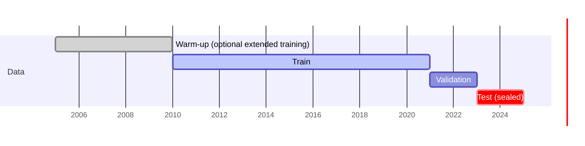
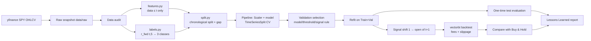
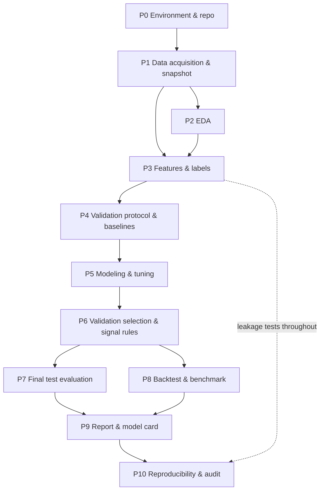

# S&P 500 (SPY) Trading Signal Model — Requirements Analysis & Development Plan

> Version: 1.0 | Date: 2026-10-10 | Module 3 Group 7
> Sources: *Machine Learning Project: S&P 500 Trading Model* (the "project brief") and *Module3 Knowledge Summary & Project Practice Guidelines* (the "knowledge guide").
> Chinese version: [SPY_Trading_Model_Requirements_and_Plan_CN.md](SPY_Trading_Model_Requirements_and_Plan_CN.md)
>
> **Note:** This is a pre-implementation requirements analysis and plan. All parameters below (dates, thresholds, windows, fees) are **default design decisions**; no experiment has been run yet. Anything marked "confirm on validation" must be decided inside the legitimate validation process and must never be back-filled from test results.

---

## 1. Project Overview

### 1.1 One-sentence problem statement

> **After the close of each trading day t**, using **only SPY daily OHLCV data available up to the close of day t**, classify **SPY's return over the next 5 trading days (Buy / Hold / Sell)** so that a **simulated trading strategy** can open/close positions **at the open of day t+1**, subject to **0.1% fees per side plus slippage**, with **validation macro-F1** as the model-selection criterion and **after-cost backtest performance versus Buy & Hold** as the practical evaluation.

### 1.2 Project profile

| Item | Content |
|---|---|
| Task type | Time-series multi-class classification (Buy=1 / Hold=0 / Sell=−1) |
| Difficulty | Advanced (the hard part is validation protocol and leakage prevention, not algorithm complexity) |
| Learning goals | ① robust time-series validation; ② preventing data leakage / look-ahead bias; ③ separating "classification score" from "executable after-cost return" |
| Grading focus | Methodology, code quality, interpretation of results — **not profit** |
| Expected outcome | ~35–40% accuracy over three balanced classes is normal; the model will very likely underperform Buy & Hold after fees, which is an acceptable conclusion |

### 1.3 Source priority

1. Explicit requirements of the project brief (mandatory);
2. Design decisions made by our group in this document (may be changed within the validation process; changes must be logged);
3. General principles and rigor corrections in the knowledge guide (followed by default).

---

## 2. Requirements Analysis

### 2.1 Functional requirements traceability matrix

| ID | Brief requirement | Course basis | Implementation decision | Acceptance criterion |
|---|---|---|---|---|
| R-01 | Historical daily SPY OHLCV | 3.6 / Stage 2 | Download SPY 2005-01-01 to 2024-12-31 via `yfinance`; store a raw CSV snapshot with fetch date | `data/raw/spy_YYYYMMDD.csv` exists; README records source, date, adjustment |
| R-02 | Convert prices to returns (non-stationary) | 3.6 stationarity | Use 1/5/10/20-day returns (`pct_change`); raw prices never used as features | No raw price columns in the feature matrix |
| R-03 | At least 3 technical indicators | Feature engineering | 4 indicators: SMA ratios, RSI(14), MACD(12,26,9), Bollinger Bands(20,2) | Each indicator in `features.py` has a formula comment and window parameters |
| R-04 | Historical volatility measure | 3.6 | 20-day rolling std of returns; ATR(14)/Close as a complement | Feature columns exist and are shown in EDA |
| R-05 | Strictly lagged features | 3.6 lag / shift | Features use only data ≤ close of t; signals executed at the open of t+1 | Truncation test passes (see 3.9) |
| R-06 | Continuous future return → 3 classes | 3.3 + 3.6 | `r_fwd(t,5)=Close(t+5)/Close(t)−1`, ±1% thresholds | Unit tests in `labels.py`; class distribution in EDA |
| R-07 | Strict chronological split, no random split | 3.6 / Stage 3 | Train 2010–2020 / Val 2021–2022 / Test 2023–2024 with a 5-day gap at boundaries; `TimeSeriesSplit` inside train | No `train_test_split`, no `shuffle=True`; split-date assertions |
| R-08 | Handle class imbalance | 3.3 / 3.4 | Primary: `class_weight="balanced"`; comparison: threshold adjustment; SMOTE optional and only inside training folds | Experiment log contains with/without balancing comparison |
| R-09 | Start with interpretable tabular models, no deep learning | 3.3 / 3.4 | Baselines → Logistic Regression → Random Forest → HistGradientBoosting (LightGBM/XGBoost optional) | Modeling notebook follows this order; no neural networks |
| R-10 | No look-ahead bias (code will be audited) | Principle 5 | All preprocessing inside Pipelines; automated leakage tests; test set accessed once | All `tests/` pass; audit checklist completed |
| R-11 | EDA notebook | Stage 2 | Feature distributions, indicator correlations, target class distribution (incl. by year) | `01_eda.ipynb` runs end-to-end |
| R-12 | Modeling notebook (core) | Stages 4–7 | Data pipeline, features, training, hyper-parameter tuning, validation selection, final test | `02_modeling.ipynb` runs end-to-end with Markdown explanations |
| R-13 | Dedicated backtesting library | Brief | `vectorbt` (fallback `backtrader`) | `03_backtest.ipynb` uses vectorbt Portfolio |
| R-14 | Fees / slippage in backtest | Brief | 0.1% fee per side + 0.05% slippage; fee sensitivity 0 / 0.05% / 0.1% / 0.2% | Backtest parameters explicit; sensitivity table |
| R-15 | Plot vs. Buy & Hold | 3.1 baseline | Buy & Hold over the same period, same capital, same fee assumption; overlaid equity curves | `outputs/figures/equity_vs_bh.png` |
| R-16 | "Lessons Learned" report | Stage 7 | Where it failed, why it under/outperformed, difficulty of market prediction | `outputs/report.md` answers the four failure-analysis questions |

### 2.2 Non-functional requirements

| ID | Requirement | Implementation |
|---|---|---|
| N-01 | Reproducibility | Fixed random seeds; pinned `requirements.txt`; raw data snapshot kept; run order in README |
| N-02 | Code quality | Reusable logic in `src/`, notebooks only call and present; docstrings; `ruff` formatting |
| N-03 | Auditability | Leakage unit tests; experiment log; test results in a separate section |
| N-04 | Honest reporting | Separate actual results, teaching examples and unverified inferences; keep failed experiments |
| N-05 | Train/serve consistency | Same `features.py` for training and backtest signals; save the full Pipeline (`joblib`) |

### 2.3 Ambiguities in the brief and our decisions

Part 5 of the knowledge guide points out several undefined points in the brief that must be fixed before work starts:

| Ambiguity | Our decision | Rationale / follow-up |
|---|---|---|
| Label return basis vs. actual execution price | Primary label as in the brief: close-to-close `Close(t+5)/Close(t)−1`; execution at the open of t+1 | Consistent with the brief; discuss the mismatch in the report and run a sensitivity experiment with an open-to-open label `Open(t+6)/Open(t+1)−1` |
| Can a signal trade at the close of t? | **No.** Full data for t exists only after the close; earliest execution is the open of t+1 | Avoids hidden look-ahead |
| Is the 0.1% fee per side or round trip? | **Per side** (0.1% on each buy and each sell), plus 0.05% slippage | Conservative; sensitivity analysis covers other interpretations |
| Meaning of Sell | Primary strategy is **long-only**: Sell = exit to cash; long/short (Sell = short) is an optional variant | Better comparability with Buy & Hold; avoids short-borrow assumptions |
| Meaning of Hold | **Keep the current position**, no trade | Reduces unnecessary turnover |
| Daily signals vs. 5-day horizon | Re-evaluate the signal daily (state machine: Buy → long, Sell → flat, Hold → unchanged); a "minimum holding period" is an optional rule confirmed on validation | Label horizon is 5 days but decisions update daily; explained in the report |
| Overlapping label windows | Adjacent samples' 5-day windows overlap; 5-trading-day gap at split boundaries so every training label is known before the next segment starts | Prevents cross-boundary leakage; also a reminder that CV samples are not independent |
| Unlabeled tail rows | The last 5 trading days cannot be labeled and are dropped | No filling or extrapolation |
| Indicator warm-up | SMA200 needs 200 days; 2005–2009 data is used only for warm-up (and an optional extended-training experiment) | Avoids NaNs being imputed into fake values |

---

## 3. Key Technical Design

### 3.1 Data

- Source: `yfinance.download("SPY", start="2005-01-01", end="2025-01-01", auto_adjust=True)`.
- Adjustment: use adjusted prices (dividends and splits) for consistent returns; document the `auto_adjust` setting in the README, since unadjusted prices would turn ex-dividend dates into false drops.
- Snapshot: after the first download, save `data/raw/spy_<fetch-date>.csv`; all notebooks read the snapshot rather than re-downloading (yfinance history can be revised).
- Data audit: trading-day continuity, missing values, duplicate dates, `High ≥ max(Open, Close)`, `Low ≤ min(Open, Close)`, Volume > 0, sanity check of extreme returns (e.g., March 2020).

### 3.2 Target label

$$r_{fwd}(t,5)=\frac{Close_{t+5}}{Close_t}-1$$

| Class | Code | Default condition |
|---|---|---|
| Buy | 1 | `r_fwd > +1.0%` |
| Hold | 0 | `−1.0% ≤ r_fwd ≤ +1.0%` |
| Sell | −1 | `r_fwd < −1.0%` |

Alternative thresholds (decided from training statistics only, compared on validation):
- **Quantile thresholds**: 33rd/67th percentiles of training `r_fwd`, giving roughly balanced classes;
- **Volatility-scaled thresholds**: `±k × σ_20(t) × √5`, so thresholds adapt to market volatility (σ uses only data ≤ t).

Internally labels may be encoded as {0,1,2} for sklearn and mapped back to {−1,0,1} on output.

### 3.3 Feature engineering (all using data ≤ close of t only)

| Group | Feature | Formula / window |
|---|---|---|
| Returns | `ret_1, ret_5, ret_10, ret_20` | `Close_t / Close_{t−k} − 1` |
| Trend (MA) | `close_sma20, close_sma50, close_sma200` | `Close_t / SMA_k(t) − 1` |
| Trend (MA) | `sma20_sma50` | `SMA20 / SMA50 − 1` |
| Momentum | `rsi_14` | Wilder smoothing: `RSI = 100 − 100/(1+RS)`, RS = avg gain / avg loss (14 days) |
| Momentum | `macd_hist` (normalized) | `MACD = EMA12 − EMA26`; `Signal = EMA9(MACD)`; `hist = (MACD − Signal)/Close` |
| Mean reversion | `bb_pctb, bb_width` | Middle band SMA20, bands ±2σ₂₀; `%B=(C−Lower)/(Upper−Lower)`; `width=(Upper−Lower)/SMA20` |
| Volatility | `vol_20` | 20-day rolling std of `ret_1` |
| Volatility | `atr_14_norm` | ATR(14) / Close |
| Volume | `vol_z20` | `(log V_t − mean₂₀(log V)) / std₂₀(log V)` |
| Calendar (optional) | `dow, month` | Day of week, month (known in advance) |

Key points:
- No `center=True` rolling; no `shift(-k)` anywhere (negative shifts allowed only in `labels.py`).
- Rolling statistics at t include the close of t; this is legitimate because execution happens at the open of t+1.
- **Learned** preprocessing such as scaling lives in an sklearn Pipeline and is fit only on training folds.
- Indicators are highly correlated (e.g., ret_5 vs. RSI); show the correlation matrix in EDA and optionally run a "de-duplicated feature subset" experiment.

### 3.4 Data split and validation protocol



- **Boundary gap**: drop the last 5 trading days of each training segment so their label windows do not reach into the next segment.
- **In-train CV**: `TimeSeriesSplit(n_splits=5, gap=5)` (expanding window) for hyper-parameter search, scored by `f1_macro`.
- **Validation set**: used to choose among candidate models, threshold schemes and signal rules (probability margin, minimum holding period).
- **Final model**: after freezing the configuration, refit on Train+Val (2010–2022).
- **Test set**: 2023–2024 is accessed **once**, only in the last section of `02_modeling.ipynb` and in `03_backtest.ipynb`; no design change afterwards. If violated, the report must state that the test set's role has changed.
- **Robustness (optional)**: walk-forward evaluation (refit yearly) to show behavior across regimes (2020 pandemic, 2022 rate hikes).

### 3.5 Class imbalance

1. Report overall and per-year class proportions in EDA (Buy expected to outnumber Sell).
2. **Primary**: `class_weight="balanced"` (supported by LR / RF / HGB).
3. **Comparison**: adjust label thresholds (quantile thresholds) or decision rules (e.g., `P(Buy) − P(Sell) > m`).
4. **SMOTE (optional)**: oversample only inside training folds via `imblearn.pipeline.Pipeline`; the report must discuss its limits on time series (synthetic samples interpolate across time and may distort temporal structure).
5. Class weights change the probability–threshold relationship, so thresholds must be re-selected on validation.

### 3.6 Baselines and candidate models

| # | Model | Purpose | Key hyper-parameters (CV search) |
|---|---|---|---|
| B0 | DummyClassifier(most_frequent) | Majority-class baseline | — |
| B1 | DummyClassifier(stratified) | Random-guess baseline | — |
| B2 | Always Buy (= always invested) | Trading baseline matching Buy & Hold | — |
| B3 | Momentum rule: `ret_20>0 and Close>SMA200 → Buy`, `ret_20<0 and Close<SMA200 → Sell` | Simple interpretable rule baseline | — |
| M1 | LogisticRegression (multinomial, StandardScaler) | Interpretable linear model | `C`, `class_weight` |
| M2 | RandomForestClassifier | Non-linear, robust | `n_estimators, max_depth, min_samples_leaf, max_features` |
| M3 | HistGradientBoostingClassifier | Boosted trees | `learning_rate, max_iter, max_depth, min_samples_leaf, l2_regularization` |
| M4 (optional) | LightGBM / XGBoost | Comparison with M3 | Similar parameters |

- Search: `RandomizedSearchCV` (or `GridSearchCV`) over the whole Pipeline with `TimeSeriesSplit`; log the number of candidates and search ranges.
- Trees tend to memorize noise: prefer shallow trees, larger leaves, smaller learning rates plus early stopping (the early-stopping slice must be a chronological split inside training data).
- Interpretation: LR coefficients (mind scaling and correlated features), permutation importance on the **validation** set; describe model associations only, no causal claims.

### 3.7 Evaluation metrics

| Level | Metric | Use |
|---|---|---|
| Classification (primary) | **Macro-F1** | Model and hyper-parameter selection (equal weight per class, so the majority class cannot hide failures) |
| Classification (secondary) | Balanced accuracy, accuracy, per-class precision/recall, confusion matrix, log loss | Full diagnosis; accuracy always reported next to the majority baseline |
| Classification (by period) | Per-year macro-F1 | Stability across market regimes |
| Backtest | Total return, CAGR, annualized volatility, Sharpe (state rf=0 assumption), max drawdown, Calmar | Risk-adjusted return |
| Backtest (trading) | Number of trades, turnover, time in market, win rate, total fees | Explain the impact of costs |

> Reference: ~35–40% accuracy over three balanced classes is normal; ~80% accuracy means check for leakage first. This is a warning sign, not a standard — final comparisons are against majority and rule baselines.

### 3.8 Backtest design

- **Library**: `vectorbt` (`Portfolio.from_signals`).
- **Signal to trade**: prediction at the close of t → whole signal series `shift(1)` → fill at the **Open** of t+1.
- **Primary strategy (long-only state machine)**: Buy → enter long if flat; Sell → exit to cash if long; Hold → keep.
- **Optional variants**: long/short (Sell = short); probability-margin filter (trade only when `max P` exceeds a threshold); 5-day minimum holding period. Variant parameters are chosen only on the validation-period backtest.
- **Costs**: `fees=0.001` (per side), `slippage=0.0005`; sensitivity: fees ∈ {0, 0.0005, 0.001, 0.002}.
- **Initial capital**: USD 100,000, fully invested (size = 100% of cash).
- **Benchmark**: Buy & Hold over the same period, same capital, same fees (buy at the first open, hold to the end).
- **Outputs**: equity curve comparison (model vs. Buy & Hold, with trade markers), drawdown curve, metrics table, fee sensitivity table.
- **Periods**: validation (2021–2022) for choosing signal rules; test (2023–2024) for the final report.

### 3.9 Look-ahead audit

| Check | Method |
|---|---|
| Feature truncation consistency | For any date t, recomputing features with data up to t must give exactly the same row t as the full computation (`tests/test_no_lookahead.py`) |
| Negative shifts only in labels | Static check: `shift(-` appears only in `labels.py` |
| Label correctness | Synthetic price series with asserted label values |
| Split boundaries | Assert `train.index.max() + gap < val.index.min()`, same for test |
| Preprocessing location | All scalers / resamplers inside Pipelines; no `fit` on the full dataset |
| Execution timing | Backtest signals must be `shift(1)`; assert first trade date is after first signal date |
| Test access | Only one place in the project reads the test segment; confirmed in code review |
| Suspiciously good results | If validation accuracy far exceeds ~45% or backtest Sharpe is abnormally high, stop and investigate |

---

## 4. System Design

### 4.1 Directory structure

```text
Module3 Group7 project/
  README.md                 # problem, data, environment, run order, summary of findings
  requirements.txt          # pinned versions
  knowledge&docs/           # course materials (read-only)
  docs/                     # this plan (CN / EN)
  data/
    raw/                    # yfinance raw snapshot
    processed/              # feature + label table (parquet/csv)
  notebooks/
    01_eda.ipynb
    02_modeling.ipynb
    03_backtest.ipynb
  src/
    config.py               # dates, thresholds, windows, fees, seeds
    data.py                 # download/load snapshot, data audit
    features.py             # indicators and features (shared by training and backtest)
    labels.py               # forward returns and 3-class labels
    split.py                # chronological split, gap, CV splitter
    models.py               # Pipelines and search spaces
    evaluate.py             # classification metrics, confusion matrix, per-year evaluation
    backtest.py             # vectorbt backtest and benchmark
  tests/
    test_no_lookahead.py
    test_labels.py
    test_split.py
  outputs/
    figures/
    metrics.json
    experiment_log.csv
    model_card.md
    report.md               # Lessons Learned
  models/
    final_pipeline.joblib
```

### 4.2 Data flow



---

## 5. Development Plan (phases and dependencies)

### 5.1 Phase dependency graph



### 5.2 Phase details

| Phase | Inputs | Main tasks | Outputs | Acceptance criteria |
|---|---|---|---|---|
| **P0 Environment & repo** | None | Create a conda env (Python 3.11 recommended for vectorbt/numba compatibility); `git init` and `.gitignore` (ignore large data and model files); create directory structure; constants in `config.py` | Environment, repo skeleton, `requirements.txt` | `import vectorbt, sklearn, yfinance` succeeds; structure matches 4.1 |
| **P1 Data acquisition & snapshot** | Environment | `data.py` downloads SPY 2005–2024; save snapshot; data audit (missing, duplicates, OHLC consistency, extremes) | `data/raw/*.csv`, audit notes | Snapshot loads offline; every audit issue has a documented handling |
| **P2 EDA** | Snapshot | Price and return series, return distribution (fat tails), volatility clustering, indicator distributions, indicator correlation matrix, target class distribution (overall / by year / by split), threshold sensitivity (class proportions under different thresholds) | `01_eda.ipynb`, `outputs/figures/eda_*` | Covers the three mandatory EDA items in the brief; findings written in Markdown |
| **P3 Features & labels** | Snapshot, EDA findings | Implement `features.py`, `labels.py`; warm-up handling; write leakage and label tests | `data/processed/`, `tests/` | `pytest` passes; feature table has no future info and no NaNs (warm-up removed) |
| **P4 Validation protocol & baselines** | Feature table | Implement `split.py` (3-way split + gap + CV splitter); run CV and validation scores for baselines B0–B3; create experiment log | E00–E03 in `experiment_log.csv` | Split assertions pass; baseline scores recorded as the reference |
| **P5 Modeling & tuning** | P4 protocol | Implement Pipelines M1→M2→M3(→M4); tune with `RandomizedSearchCV` + `TimeSeriesSplit`; compare with/without class weights, threshold schemes, de-duplicated feature subset | CV macro-F1 and best params per candidate | Each experiment changes one main factor and is logged; no test access |
| **P6 Validation selection & signal rules** | P5 candidates | Compare candidates on validation (macro-F1, confusion matrix, per-year); choose signal rules (probability margin, minimum holding) on the validation-period backtest; freeze final configuration | Frozen configuration (in `config.py`) with rationale | Selection rule stated in advance; final config traceable to experiment IDs |
| **P7 Final test evaluation** | Frozen config | Refit on Train+Val, save `final_pipeline.joblib`; one-time test evaluation of all classification metrics; compare with baselines | `metrics.json`, test confusion matrix | Test run once; results shown next to baselines |
| **P8 Backtest & benchmark** | Final model signals | vectorbt backtest (test period primary, validation secondary); Buy & Hold benchmark; fee/slippage sensitivity; long-only vs. optional long/short | `03_backtest.ipynb`, equity comparison plot, metrics table | Fees included; Buy & Hold overlay plot; complete sensitivity table |
| **P9 Report & model card** | P7, P8 results | Write Lessons Learned (Section 9); model card (data range, target, features, split, metrics, limitations, intended use); README summary | `report.md`, `model_card.md`, README | Answers the four failure-analysis questions; actual results separated from inference |
| **P10 Reproducibility & audit** | All outputs | Re-run all notebooks from scratch in a fresh environment; audit against the Section 8 checklist; formatting check | Audit record, final submission | Re-run from snapshot reproduces results (minor library-version differences explained) |

### 5.3 Key milestones (gates)

| Gate | When | Pass condition |
|---|---|---|
| G1 Data ready | End of P1 | Snapshot and audit complete |
| G2 Leak-free features | End of P3 | All leakage tests pass |
| G3 Config frozen | End of P6 | Final model, thresholds and signal rules fixed and logged |
| G4 Test unsealed | Start of P7 | Test set may be read only after G3 |
| G5 Delivery | End of P10 | Checklist fully ticked |

---

## 6. Experiment Log Template

| Exp ID | Data/split version | Label scheme | Feature set | Imbalance handling | Model/params | CV macro-F1 (mean ± fold std) | Val macro-F1 | Val-period backtest (after cost) | Conclusion |
|---|---|---|---|---|---|---|---|---|---|
| E00 | v1 / 2010–20·21–22 | ±1%, 5d | — | — | Dummy most_frequent | not run | not run | — | Reference |
| E01 | same | same | all | balanced | LR C=? | not run | not run | not run | TBD |
| … | | | | | | | | | |

Rules:
- Cells not yet run say "not run"; never fill them with course example numbers;
- Fold std is neither a confidence interval nor a significance test;
- Test results are reported in a separate table only after freezing.

---

## 7. Risks and Mitigations

| Risk | Symptom | Mitigation |
|---|---|---|
| Data leakage / look-ahead | Abnormally high accuracy or Sharpe | Audit in Section 3.9; suspect leakage before trusting results |
| Overfitting thresholds/rules on validation | Good on validation, poor on test | Limit candidates; keep rules simple; report validation–test gap |
| Regime change (2020 pandemic, 2022 rate hikes, strong 2023–24 rally) | Large performance differences across years | Per-year evaluation; optional walk-forward; discuss in report |
| Fees eat returns | High-turnover strategy loses after costs | Turnover statistics; probability margin and minimum holding; fee sensitivity |
| Class distribution drift | Buy/Sell ratio differs between training and test | Report class proportions per segment; compare fixed vs. volatility-scaled thresholds |
| Label basis vs. execution price mismatch | Good classification, poor backtest | Sensitivity experiment (open-to-open label); explain in report |
| Overlapping labels make CV optimistic | Inflated CV scores | Gap setting; never treat fold variation as a confidence interval |
| Library compatibility | vectorbt/numba may not install on the current Python 3.14 | Dedicated conda env (Python 3.11); fallback backtrader |
| yfinance data changes / API failure | Re-runs differ | Local snapshot; record fetch date |
| Multiple comparisons | Finding a "lucky" result after many tries | Log all experiments, including failures; report number of attempts |

---

## 8. Deliverables and Completion Checklist

### 8.1 Deliverables (from the brief)

- [ ] EDA notebook (feature distributions, indicator correlations, target class distribution)
- [ ] Modeling notebook (data pipeline, features, training, hyper-parameter tuning)
- [ ] Backtest with a dedicated library (including fees/slippage)
- [ ] Model equity vs. Buy & Hold plot
- [ ] Lessons Learned report

### 8.2 Methodology audit checklist (knowledge guide, Part 5)

- [ ] Problem, sample unit (trading day), prediction time (close of t), label and window (5 days) defined
- [ ] Data source, version, adjustment, coverage and cleaning are traceable
- [ ] Fair simple baselines exist (majority, random, always-Buy, momentum rule, Buy & Hold)
- [ ] Split strictly chronological, with boundary gap
- [ ] All training statistics, resampling and feature selection fit only within the training range
- [ ] Hyper-parameters, thresholds, signal rules and early stopping come from in-train CV or validation
- [ ] Test set was not used to change the design
- [ ] Metrics match the action; accuracy or pretty curves are not used in place of evidence
- [ ] Backtest simulates realistic execution (open of t+1) and includes costs
- [ ] Feature importance not interpreted as causation
- [ ] Actual results, examples and unverified inferences labelled separately; failures and per-period analysis included
- [ ] Code, data snapshot and environment reproducible from the README
- [ ] Model card states intended use and limitations

---

## 9. Lessons Learned Report Skeleton

```markdown
# Lessons Learned
## 1. Results summary
- Test classification metrics vs. baselines; after-cost backtest vs. Buy & Hold (same period, capital, fees)
## 2. Where the model failed
- Confusion matrix: which classes are most confused (Hold expected to be confused with neighbors most)
- Performance by year / market regime
## 3. Why it under- (or out-) performed the benchmark
- Fees and turnover; missed big up days; label basis vs. execution price; class drift
## 4. Robust signal or chance pattern?
- Validation–test gap; stability of feature importance; leakage investigation results
## 5. Why predicting financial markets is hard
- Low signal-to-noise, near-efficient markets, non-stationarity and regime change, fat tails, few effective samples due to overlapping labels
## 6. Next steps and unverified hypotheses
- Which changes might help (data/features/rules) and which are only hypotheses
```

---

## 10. Appendix

### 10.1 Glossary (English–Chinese)

| English | 中文 | Short definition |
|---|---|---|
| Look-ahead bias | 前视偏差 | Using information not yet available at the time |
| Data leakage | 数据泄漏 | Training or selection uses information unavailable at prediction time |
| Lagged feature | 滞后特征 | Feature computed only from past data |
| Horizon | 预测跨度 | Number of future days the label looks at (5 here) |
| Gap / Embargo | 间隔 | Samples dropped at split boundaries to avoid overlapping label windows |
| Expanding window | 扩张窗口 | Validation scheme where the training set grows over time |
| Class weight | 类别权重 | Training that increases the cost of minority-class errors |
| Macro-F1 | 宏平均 F1 | Unweighted mean of per-class F1 |
| Slippage | 滑点 | Difference between expected and actual fill price |
| Buy & Hold | 买入持有 | Benchmark that buys at the start and holds throughout |
| Maximum drawdown | 最大回撤 | Largest peak-to-trough decline in equity |
| Sharpe ratio | 夏普比率 | Excess return / return volatility (annualized) |

### 10.2 Metric formulas

- Precision = TP/(TP+FP); Recall = TP/(TP+FN); F1 = 2PR/(P+R)
- Macro-F1 = (F1_Buy + F1_Hold + F1_Sell) / 3
- Balanced accuracy = mean of per-class recall
- CAGR = (final equity / initial equity)^(252 / trading days) − 1
- Sharpe (annualized, rf=0) = mean(daily return) / std(daily return) × √252
- Max drawdown = min_t (V_t / max_{s≤t} V_s − 1)

### 10.3 References

- Project brief: `knowledge&docs/Machine Learning Project_ S&P 500 Trading Model.docx`
- Knowledge guide: `knowledge&docs/Module3_知识总汇与项目实践规范.md` (Part 3 workflow, Part 4 templates, Part 5 S&P 500 mapping)
- scikit-learn docs: `TimeSeriesSplit`, `Pipeline`, `HistGradientBoostingClassifier`
- vectorbt docs: `Portfolio.from_signals`
