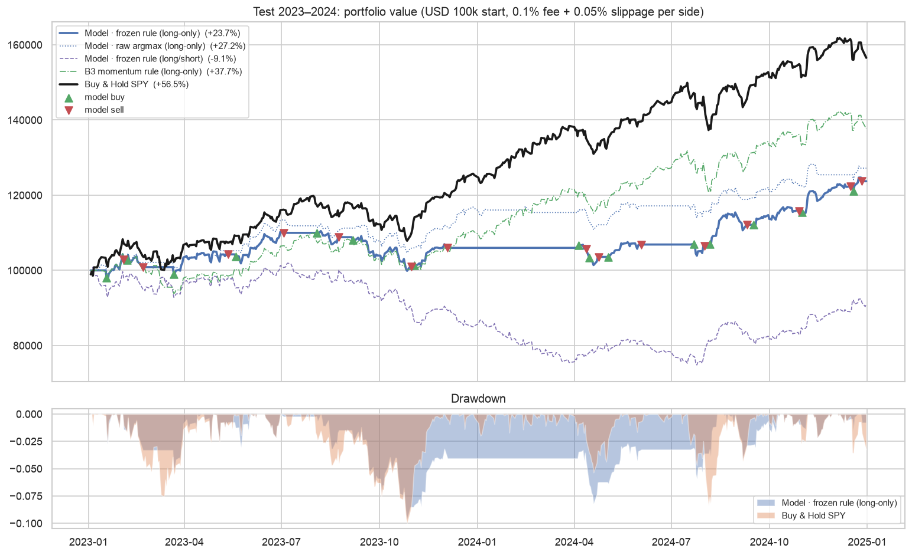

# Lessons Learned — SPY Buy / Hold / Sell Trading Signal Model

Module 3 Group 7 · 2026-10-12 · 中文版：[report_CN.md](report_CN.md)

All numbers below come from the executed notebooks (`notebooks/01_eda`, `02_modeling`, `03_backtest`) and from `outputs/metrics.json` / `outputs/backtest_metrics.json`. Data: SPY daily OHLCV from yfinance (adjusted), snapshot `data/raw/spy_20261010.csv`.

## 0. Setup in one paragraph

Each trading day *t*, after the close, a classifier uses 15 strictly-lagged features (returns, SMA ratios, RSI-14, MACD histogram, Bollinger %B/width, 20-day volatility, ATR, volume z-score) to predict whether SPY's next-5-day return will be > +1% (Buy), < −1% (Sell) or in between (Hold). The data is split chronologically: Train 2010–2020 / Validation 2021–2022 / Test 2023–2024, with a 5-day gap at each boundary and `TimeSeriesSplit(gap=5)` inside Train. Imbalance is handled with `class_weight="balanced"`, and models are selected by validation macro-F1. The frozen model is a **Random Forest**. Its signals are backtested with **vectorbt**: fill at the next open, 0.1% fee + 0.05% slippage per side, long-only.

## 1. Results summary

**Classification — sealed test set 2023–2024 (497 labelled days, evaluated once):**

| Model | Accuracy | Balanced acc. | **Macro-F1** | F1 Sell | F1 Hold | F1 Buy |
|---|---|---|---|---|---|---|
| **RF (final, E06)** | **0.449** | **0.413** | **0.408** | 0.250 | 0.590 | 0.384 |
| B0 majority class | 0.417 | 0.333 | 0.196 | 0 | 0.588 | 0 |
| B1 stratified random | 0.326 | 0.309 | 0.305 | 0.206 | 0.405 | 0.304 |
| B2 always Buy | 0.398 | 0.333 | 0.190 | 0 | 0 | 0.570 |
| B3 momentum rule | 0.352 | 0.292 | 0.238 | 0 | 0.226 | 0.488 |

Validation macro-F1 of the same configuration was 0.404, so test (0.408) is consistent with it.

**Backtest — test period 2023-01-03 → 2024-12-31, USD 100k, after costs:**

| Strategy | Total return | CAGR | Sharpe | Max DD | Trades | Fees paid |
|---|---|---|---|---|---|---|
| **Buy & Hold SPY** | **+56.5%** | 25.2% | **1.82** | −10.0% | 1 | $100 |
| B3 momentum rule | +37.7% | 17.4% | 1.37 | −10.2% | 3 | $491 |
| Model · raw argmax | +27.2% | 12.8% | 1.36 | −7.8% | 28 | $6,311 |
| **Model · frozen rule (primary)** | **+23.7%** | 11.3% | 1.14 | −9.6% | 15 | $3,237 |
| Model · frozen rule, long/short | −9.1% | −4.7% | −0.29 | −26.6% | 31 | $5,442 |

**Verdict.** The model is a statistically better *classifier* than every naive baseline (+0.10 macro-F1 over the best one). As a *trading strategy* it **underperforms Buy & Hold by ≈ 33 percentage points** and also loses to a 2-line momentum rule. This is the outcome the brief anticipated. The rest of this report explains why.

## 2. Where the model failed

1. **It cannot tell up from down.** On test, 39 of 92 true Sell weeks were predicted Buy, and 56 of 198 true Buy weeks were predicted Sell. On validation the Buy and Sell rows of the confusion matrix are almost identical (Sell → 58 Sell / 64 Buy; Buy → 77 Sell / 77 Buy). The macro-F1 gain over baselines comes almost entirely from recognising **Hold** (test Hold recall 0.62).
2. **Its probabilities are barely informative.** Test log loss is 1.058, against 1.099 (= ln 3) for a uniform guess. The largest predicted P(Buy) on test is ≈ 0.48.
3. **It sat in cash during a rally.** The primary strategy sold on 4 Dec 2023 and only re-entered on 5 Apr 2024, while SPY rose ≈ 14%. During those months the model emitted 51 Sell, 30 Hold and 0 Buy signals: after strong advances (high RSI, %B near the upper band) it rates P(Sell) slightly above P(Buy). This mild mean-reversion pattern was learned in 2010–2020 and does not hold in a persistent trend.
4. **Regime shift hurt one feature outright.** On validation (2021–2022), permuting `close_sma200` *improved* macro-F1 by ≈ 0.02. The relationship learned when SPY was mostly above its 200-day average misled the model in the 2022 bear market.
5. **Validation-selected trading choices did not carry over.** The signal rule (`margin=0.05, min_hold=5`) won on validation (Sharpe 0.07 vs −0.06 for argmax). On test, plain argmax did better (+27.2% vs +23.7%).

## 3. Why it underperformed the benchmark

- **No direction skill + an upward-drifting market.** On days the strategy was in cash, SPY averaged +0.10%/day; on days it was invested, +0.09%/day. Avoided days were not worse days. While out (210 of 501 days) it missed a compounded +21.9%, and it was invested on only 5 of the 10 best days. Without timing skill, every day in cash has a positive expected cost in a market that drifts upward — and 2023–2024 was a strong bull market.
- **Transaction costs.** At 0.1% fee + 0.05% slippage per side, costs removed ≈ 6 pp from the primary strategy (29.4% → 23.7%) and ≈ 11 pp from argmax (38.3% → 27.2%). On validation, argmax trading paid ≈ 8% of capital in costs. **But costs are not the main reason**: even at zero cost the model (27–38%) stays far below Buy & Hold (57%).
- **Label ≠ trade.** The label measures close(t) → close(t+5), while the strategy fills at open(t+1) and holds for a variable time decided by daily signals. An execution-aligned open→open label (E13) scored better on validation (macro-F1 0.393 vs 0.359 for the same LR, best LR backtest). The mismatch costs something, though E13 still had a negative validation Sharpe.
- **Short side is costly in a bull market.** Low Sell precision turns into losing short positions (−9.1% for long/short).

## 4. Robust signal or chance pattern?

Evidence that the *classification* result is genuine and leak-free:
- The automated look-ahead audit (`pytest`, 15 tests) passes. It checks that features are identical when future data is truncated or shocked ×10, that no negative shifts or centred windows exist outside `labels.py`, that segment and CV boundaries have gap > 5 days, and that backtest fills happen at the next bar's open.
- Validation and test macro-F1 agree (0.404 vs 0.408). Accuracy (44.9%) sits in the range the brief calls normal; nothing near the 80% that would signal leakage.
- The test segment is loaded in exactly one place (`get_segments(include_test=True)` in §9 of `02_modeling`), after the configuration was frozen.

Evidence that the edge is small and fragile:
- Gradient boosting reached 0.74 macro-F1 on its training folds but only 0.32 on validation, which shows how easily noise is memorised. RF also shows a train/CV gap (0.54 vs 0.40).
- CV fold standard deviations (0.02–0.04) are as large as most differences between LR variants.
- The signal-rule choice depended on ~13–41 trades in two years and did not generalise.
- One two-year test period is a single realisation; no significance claim is made.

## 5. Why predicting financial markets is hard (what this project showed)

- **Low signal-to-noise.** Daily SPY returns are nearly uncorrelated with their own past, while absolute returns are clearly autocorrelated (volatility clustering), and the distribution has an excess kurtosis of 14.9. Volatility is forecastable; direction is not. Our features ended up predicting "big move vs quiet week", which is exactly that.
- **Near-efficient market.** Any simple, persistent pattern in widely-watched indicators of the most liquid ETF is likely to be competed away; ours were weak and unstable.
- **Non-stationarity.** The class mix itself swings by year (2017: 74% Hold / 5% Sell; 2022: 41% Sell). Validation (2021–22) and test (2023–24) were very different regimes, and relationships such as `close_sma200` flipped usefulness.
- **Overlapping labels shrink the real sample.** Neighbouring 5-day labels share 4 days (lag-1 autocorrelation of the target is 0.77), so 2,764 training rows contain far fewer independent observations than it seems.
- **Costs and drift raise the bar.** A strategy must beat a benchmark that is invested 100% of the time in an asset with positive drift, after paying ≈ 0.3% per round trip.

## 6. Next steps and unverified hypotheses

Ideas that might help (none tested here, so these are hypotheses, not results):
- Treat the task as **volatility / "big move" prediction** (where there is signal) and use it for position sizing or risk management rather than for direction.
- Map labels to actions differently: e.g. stay invested by default and exit only on high-confidence Sell, so the up-drift is not given away.
- Use the execution-aligned label (E13) as the primary target and run walk-forward evaluation (yearly refits) across more regimes (2008, 2020, 2022) to judge stability.
- Add information not derived from SPY's own price, such as rates, credit spreads or the VIX term structure. It would need the same availability-time discipline.
- Probability calibration and a cost-aware decision rule (trade only when expected edge > round-trip cost).

## 7. Process notes and deviations from the plan

- **Bug found after the test set was opened.** The backtest summary measured returns from the first bar's close instead of from initial cash, so the benchmark's entry fee and first-day move were omitted. This was fixed in `src/backtest.py::summarize` and both notebooks were re-run. The validation-based selections were re-computed by the same code and the **frozen configuration was unchanged** (`frozen_config.json` byte-identical). No model, threshold or rule was changed. As a result, `02_modeling` was executed twice end-to-end, with identical test classification results both times. A third, clean end-to-end run of all notebooks was done as the reproducibility check (P10). Validation, test and backtest metrics were identical to the previous run.
- Optional items not done: LightGBM/XGBoost (M4), walk-forward evaluation.
- Planned split boundaries, thresholds, cost assumptions and selection rules were all used as written in `docs/`.
