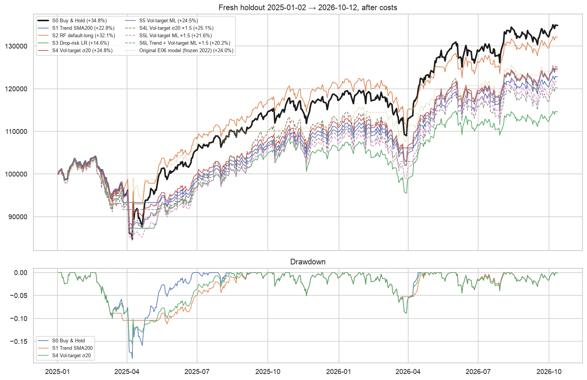

# 有没有模型能跑赢 Buy & Hold SPY？——策略研究

Module 3 Group 7 · 2026-10-13 · English: [research_report.md](research_report.md) · Notebooks：`04_strategy_research.ipynb`、`05_holdout_2025.ipynb`

## 结论

**没有。**我们事先登记了 9 种策略，涵盖规则、ML 信号和加杠杆的波动率目标策略。扣除成本后，没有一个的收益超过 Buy & Hold：10 年滚动开发期（2013–2022）没有，全新数据（2025-01 至 2026-10）上也没有。表现较好的策略能做到的是**降低风险**：牺牲部分收益，换来相近或更高的 Sharpe 和明显更小的回撤。而且这种优势在不同时期也不稳定。

## 检验方法及原因

原测试期（2023–2024）已经用过，在上面挑策略等于偷看考卷。因此在跑任何回测、下载 2025 年以后数据**之前**，先写好并哈希固定了新的检验方案（[preregistration.md](preregistration.md)）：

- **开发期**：2013–2022 逐年滚动重训，每一年只用标签在当年 1 月 1 日之前已知的历史数据训练。选择规则：年化收益（CAGR）高于 Buy & Hold 的策略才有资格入选，入选者中取 Sharpe 最高的一个。
- **次要参考**：2023–2024，已经看过，只报告结果、不参与选择。
- **全新留出期**：2025-01-02 至 2026-10-12，登记完成后才下载，报告**全部**候选的结果。
- **成本与执行**：与主项目相同，次日开盘成交，每侧手续费 0.1% 加滑点 0.05%。加杠杆时借入资金按年息 5% 计。
- **代码校验**：新增 4 项测试，检查以下几点：
  - 滚动训练的最后一天距离被预测年份超过 h 天；
  - 杠杆模拟器在不加杠杆时与 vectorbt 结果一致；
  - 借款利息计算正确；
  - 未来波动率标签恰好覆盖 t+1 到 t+h。
  
  最后一项在出结果之前就发现了一个真实 bug，已修复。

## 结果

| 策略 | 开发期 CAGR | 开发期 Sharpe | 开发期最大回撤 | 留出期收益 | 留出期 Sharpe | 留出期最大回撤 |
|---|---|---|---|---|---|---|
| **S0 Buy & Hold** | **12.2%** | 0.75 | −33.7% | **+34.8%** | **1.09** | −18.8% |
| S1 趋势（收盘价 > SMA200） | 8.3% | 0.74 | −20.0% | +22.8% | 1.08 | **−11.2%** |
| S2 RF 三分类，默认持仓 | 8.2% | 0.56 | −31.3% | +32.1% | 1.06 | −16.6% |
| S3 下跌风险分类器（LR） | 7.8% | 0.58 | −25.5% | +14.6% | 0.65 | −16.2% |
| S4 波动率目标（过去 20 日 σ） | 10.9% | **0.89** | **−17.8%** | +24.8% | 0.98 | −15.7% |
| S5 波动率目标（ML 预测 σ） | 10.1% | 0.80 | −22.3% | +24.5% | 1.00 | −16.8% |
| S4L 过去 σ 波动率目标，≤1.5 倍 | 11.0% | 0.76 | −18.2% | +25.1% | 0.86 | −17.7% |
| S5L ML σ 波动率目标，≤1.5 倍 | 8.7% | 0.63 | −24.4% | +21.6% | 0.79 | −18.4% |
| S6L 趋势 + ML 波动率目标，≤1.5 倍 | 6.2% | 0.53 | −23.7% | +20.2% | 0.83 | −12.5% |
| *原项目 E06 模型（参考）* | — | — | — | +24.0% | 0.96 | −12.9% |

按事先规则，开发期**没有任何策略入选**。

## 学到了什么

1. **择时策略输在 V 型反弹。**开发期内，各候选主要在 2022 年这种缓慢下跌的熊市中赢过 Buy & Hold。输得最多的是 2019 年（S1 落后 17 个百分点）和 2020 年（S3 落后 30 个百分点、S2 落后 20 个、S1 落后 12 个）。2025 年 4 月的暴跌和反弹在全新数据上重演了同样的情形。市场最好的交易日往往紧跟在最差的交易日之后，下跌后降低仓位的策略恰好会错过它们。
2. **波动率可以预测，但光靠这一点赢不了市场。**ML 波动率预测在样本外解释了 34% 的 log 20 日波动率变化，过去 20 日波动率只能解释 8%。但用 ML 预测来定仓位的 S5，并没有赢过用过去波动率定仓位的 S4。统计指标更好，不等于策略更好。
3. **杠杆没能补上差距。**即使借款完全免费，留出期表现最好的杠杆策略也只有 +27.6%，Buy & Hold 是 +34.8%。原因是这类策略在平静期加杠杆，在冲击后减杠杆，而冲击之后往往紧接着反弹。
4. **短窗口会选错模型。**在已经用过的 2023–2024 上，S2 **跑赢**了 Buy & Hold（+63.7% 对 +57.0%）。但它在 2013–2022 是最差的几个之一（年化 8.2% 对 12.2%），在留出期也落后（+32.1% 对 +34.8%）。如果当初按 2023–2024 来选，得到的就是一个假发现。
5. **真正能做到的改进是控制风险。**S1 和 S4 的最大回撤明显更小：留出期 −11.2% 和 −15.7%，对比 −18.8%；开发期 −20.0% 和 −17.8%，对比 −33.7%。它们的 Sharpe 与 Buy & Hold 相近。对更看重控制亏损的投资者，这是合理的取舍，但并不是更高的收益。而且这种 Sharpe 优势也不稳定：S4 在开发期是 0.89 对 0.75，在留出期变成 0.98 对 1.09。

## 本研究的局限

- 只测试了 9 个候选和一个资产，没有用利率、信用利差、VIX 期货、市场广度等其他信息。
- 留出期数据是全新的，但研究者并非完全不知情：AI 研究者对 2025 年的市场事件有一般了解，这一点已在事先登记中说明。
- 留出期只有 445 个交易日，排名由单一时期决定，没有做显著性检验。
- 5% 的借款利率是假设值。事后用 0% 和 2% 复核，结论不变。

## 如果还想继续找

以下只是假设，需要另做一次独立的事先登记研究来检验，不是结论：
- **等风险比较**：把风险调整后表现最好的策略加杠杆到与 Buy & Hold 相同的波动率，再看收益能否超过 Buy & Hold。前提是 Sharpe 优势真实存在，而这里它并不稳定。
- **引入外部数据**：例如 VIX 期限结构、信用利差，用来预测回撤，同时必须严格遵守信息可用时间。
- **用更长、更多样的历史检验**：例如加入 2000–2002 年、2008 年或其他指数，再决定是否信任任何择时规则。
